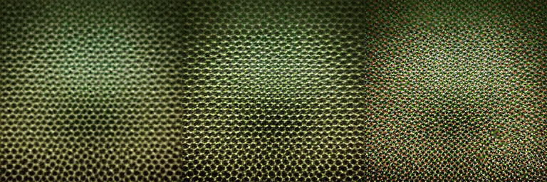

<div align="center">

# APEX: Asynchronous Prefix Denoising for Extreme Compression

David Dinkevich, Nisan Chiprut, Yoav HaCohen, Dani Lischinski

<p align="right">
  <a href="https://daviddinkevich.github.io/APEX/"></a>
</p>

</div>

## Abstract

Fewer latent tokens promise cheaper diffusion. Yet aggressive latent compression creates a reconstruction-generation dilemma: adding channels improves reconstruction but makes generation harder. We introduce APEX, short for Asynchronous Prefix denoising for EXtreme compression, which pairs a hierarchical latent space with asynchronous denoising over channel groups. Our autoencoder orders channel prefixes from structure to detail, while one shared denoiser generates them at staggered local times without adding tokens. On ImageNet-512, APEX outperforms existing methods at every evaluated channel count under 64× and 128× compression. At matched training and guided sampling compute, it also outperforms a 256-token model at every evaluated budget, with larger gains at lower compute.

<p align="center">
  
</p>

<p align="center">
  Level 0, then Level 1, then Level 2.
</p>

## This repository

`vae/` is the community DC-AE trainer ([lavinal712/AutoencoderKL](https://github.com/lavinal712/AutoencoderKL), branch `dc-ae`) with level-prefix supervision.

`sit/` is the official [SiT](https://github.com/willisma/SiT) trainer with the staggered clock.

Latent precomputation is [LightningDiT](https://github.com/hustvl/LightningDiT) `extract_features.py`. It encodes each ImageNet image and its horizontal flip with the trained autoencoder and writes both.

Train the autoencoder, extract latents, then train SiT. Licenses are in [THIRD_PARTY.md](THIRD_PARTY.md).

## Installation

Two environments. Install a CUDA build of PyTorch first, then the requirements file. `vae/requirements.txt` pins torch. Swap that pin if it does not match your CUDA.

```bash
git clone https://github.com/DavidDinkevich/APEX.git
cd APEX
```

Autoencoder:

```bash
conda create -n apex-vae python=3.10 -y
conda activate apex-vae
pip install torch torchvision --index-url https://download.pytorch.org/whl/cu124
pip install -r vae/requirements.txt
```

Diffusion:

```bash
conda create -n apex-sit python=3.10 -y
conda activate apex-sit
pip install torch torchvision --index-url https://download.pytorch.org/whl/cu124
pip install -r sit/requirements.txt
```

## Train the autoencoder

From `vae/`. Set `root_dir` in the yaml to an ImageNet folder with `train/` and `val/`.

```bash
cd vae
torchrun --nproc_per_node=4 --nnodes=1 main.py \
    --base configs/apex-f64c8-32-128_phase1.yaml \
    --train \
    --scale_lr False
```

Phase 2 and 3 resume from the previous checkpoint:

```bash
torchrun --nproc_per_node=4 --nnodes=1 main.py \
    --base configs/apex-f64c8-32-128_phase2.yaml \
    --train \
    --scale_lr False \
    --resume_from_checkpoint /path/to/last.ckpt
```

```bash
torchrun --nproc_per_node=4 --nnodes=1 main.py \
    --base configs/apex-f64c8-32-128_phase3.yaml \
    --train \
    --scale_lr False \
    --resume_from_checkpoint /path/to/last.ckpt
```

The example is official `dc-ae-f64c128-in-1.0`. Channel prefixes are 8, 32, and 128, scored at 128, 256, and 512. Crops are 512.

## Extract latents

From `sit/`, in the autoencoder environment, after phase 3. The script is [LightningDiT `extract_features.py`](https://github.com/hustvl/LightningDiT/blob/main/extract_features.py). It encodes each image and the same image flipped left-right, and writes both. Set `ckpt_path` at the top of the yaml before running.

```bash
cd sit
accelerate launch --num_processes 4 extract_features.py \
    --config ../vae/configs/apex-f64c8-32-128_phase3.yaml \
    --data_path /path/to/ImageNet/train \
    --output_path /path/to/latents \
    --image_size 512
```

```
latents/apex-f64c8-32-128_phase3_imagenet_train_512/
├── latents_rank00_shard000.safetensors
├── latents_rank00_shard001.safetensors
└── ...
```

Each shard holds `latents`, `latents_flip`, and `labels`.

## Train diffusion

From `sit/`. Training uses their latent loader. It picks either encoding with equal probability and normalizes with `latents_stats.pt`.

```bash
cd sit
LATENT_DIR=/path/to/latents/apex-f64c8-32-128_phase3_imagenet_train_512 NPROC=8 bash scripts/train_f64c8-32-128-p09-g025.sh
```

SiT-XL/1, gap 0.25, `p_L0` 0.9.

Sample (250 steps, CFG on all channels):

```bash
CKPT=/path/to/checkpoint.pt bash scripts/sample_f64c8-32-128-p09-g025.sh
```

Writes `sample_latents.pt`. Decode with the same autoencoder.

## License

MIT. See [LICENSE](LICENSE). Third-party licenses stay in `vae/` and `sit/`.
